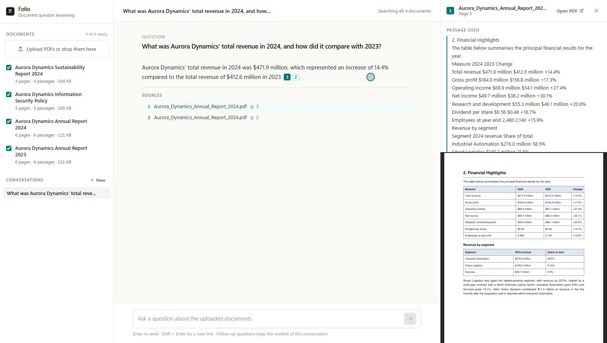
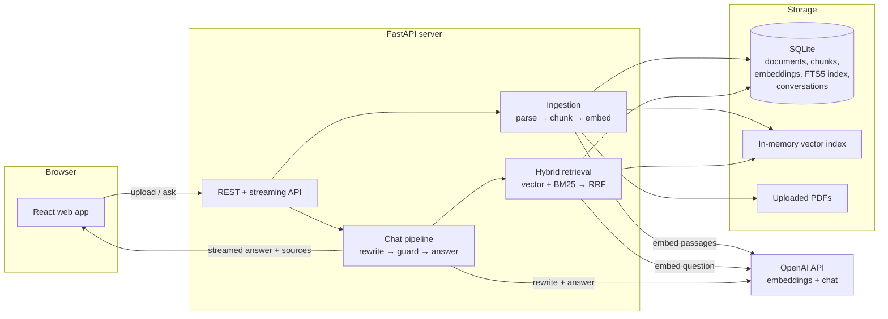

# Folio — Intelligent Multi-Document RAG System

Folio lets you upload multiple PDF documents and ask questions about them in plain English.
It retrieves the relevant passages, generates an answer that is grounded only in those passages,
shows the exact source (document and page) for every statement, tells you when the information
is not in the documents, and remembers the conversation so follow-up questions work naturally.



**Demo video (2.5 min, with subtitles):** [demo/demo.mp4](demo/demo.mp4) · subtitles: [demo/demo.srt](demo/demo.srt)

---

## Contents

- [What it does](#what-it-does)
- [Architecture](#architecture)
- [Quick start](#quick-start)
- [Configuration](#configuration)
- [Using the app](#using-the-app)
- [How it works](#how-it-works)
- [Testing and evaluation](#testing-and-evaluation)
- [API reference](#api-reference)
- [Project structure](#project-structure)
- [Design decisions](#design-decisions)
- [Limitations and next steps](#limitations-and-next-steps)

---

## What it does

| Requirement | How Folio meets it |
|---|---|
| Upload multiple PDF documents | Drag-and-drop or file picker, several files at once. Each file is parsed, chunked and indexed in the background with a live status. Duplicate files are detected by content hash. |
| Ask questions in natural language | Chat interface with streamed answers. |
| Retrieve relevant information | Hybrid retrieval: semantic vector search plus BM25 keyword search, merged with Reciprocal Rank Fusion. |
| Accurate, context-aware answers from an LLM | An OpenAI chat model answers using only the retrieved passages, under a strict grounding prompt. |
| Answers grounded in the documents | The model sees only numbered excerpts and must cite each statement. Citations that point to a non-existent source are removed. |
| Source references | Every statement has a numbered reference. Clicking it shows the passage and opens the original PDF at the cited page. |
| Handle unavailable information | Two safeguards: a similarity threshold that refuses before calling the model, and a prompt rule that makes the model reply "I couldn't find that information in the uploaded documents." |
| Conversational context | Conversations are stored. A follow-up such as "How much did they pay for it?" is rewritten into a standalone question before retrieval, and recent turns are passed to the model. |

Also included: searching only selected documents, saved conversation history, an automated
test suite that runs without an API key, and an end-to-end evaluation script.

---

## Architecture



**Ingestion** (once per document)

```
PDF → text per page → clean-up → chunks (≈1,200 characters, sentence-aware, with overlap)
    → embeddings → stored in SQLite (text, page number, vector) + keyword index + vector index
```

**Answering** (once per question)

```
question + chat history
    → rewrite into a standalone question          (conversation memory)
    → vector search  +  keyword search
    → Reciprocal Rank Fusion → top 6 passages
    → relevance guard (refuse if nothing is close enough)
    → LLM answers from the numbered passages only, with citations (streamed)
    → citations renumbered, validated and saved with the conversation
```

| Layer | Technology |
|---|---|
| Web interface | React 19, TypeScript, Vite, Tailwind CSS |
| API | Python 3.11, FastAPI, Server-Sent Events for streaming |
| PDF parsing | PyMuPDF |
| Embeddings | OpenAI `text-embedding-3-small` (1,536 dimensions) |
| Answer generation | OpenAI `gpt-4o-mini` (configurable) |
| Vector search | Exact cosine similarity with NumPy |
| Keyword search | SQLite FTS5 (BM25 ranking) |
| Storage | SQLite (single file, no separate database server) |

---

## Quick start

### Prerequisites

| Tool | Version | Check with |
|---|---|---|
| Python | 3.11 or newer | `python --version` |
| Node.js | 20 or newer | `node --version` |
| Git | any recent | `git --version` |
| OpenAI API key | — | create one at <https://platform.openai.com/api-keys> |

### Step 1 — Clone the repository

```bash
git clone https://github.com/shamz004/Multi-Model-Rag.git
cd Multi-Model-Rag
```

### Step 2 — Create your `.env` file from `.env.example`

The repository contains a template called `.env.example`. Copy it to a new file named `.env`:

| Your terminal | Command |
|---|---|
| Windows Command Prompt | `copy .env.example .env` |
| Windows PowerShell | `Copy-Item .env.example .env` |
| macOS / Linux / Git Bash | `cp .env.example .env` |

Open `.env` in any text editor and paste your OpenAI key on the first setting, with no spaces
or quotes:

```dotenv
OPENAI_API_KEY=sk-...your-key...
```

Every other setting already has a working default and can be left as it is. The `.env` file is
ignored by Git, so your key is never committed.

### Step 3 — Start the application

**Option A: one command**

| System | Command |
|---|---|
| Windows | `start.bat` |
| macOS / Linux | `./start.sh` |

The script creates the Python virtual environment, installs the dependencies, builds the web
interface and starts the app. On Windows it also opens the browser for you.

**Option B: manual steps**

```bash
# Python environment and dependencies
python -m venv .venv
.venv\Scripts\activate              # macOS/Linux: source .venv/bin/activate
pip install -r requirements.txt

# Build the web interface (one time)
cd frontend
npm install
npm run build
cd ..

# Run the app
python -m uvicorn app.main:create_app --factory --app-dir backend --port 8010
```

### Step 4 — Open the app

Go to <http://localhost:8010>. Upload the PDFs from the [`sample_docs/`](sample_docs) folder
(or your own) and ask a question.

To use a different port, set `PORT` before running the start script (for example
`set PORT=9000` on Windows) or change `--port` in the manual command.

### Verify your setup (optional)

```bash
python scripts/check_openai.py
```

This confirms that the key is accepted and that the configured models are available to your
account. It never prints the key.

### Sample documents

Four sample reports for a fictional company are in [`sample_docs/`](sample_docs): two annual
reports (2023 and 2024), a sustainability report and an information security policy. All
figures in them are invented, so a correct answer can only have come from the documents and not
from the model's general knowledge. They are generated by
`python scripts/make_sample_reports.py`. Any other text-based PDFs work the same way.

### Troubleshooting

| Symptom | Fix |
|---|---|
| Yellow banner "OpenAI API key is not configured" | `.env` is missing or `OPENAI_API_KEY` is empty. Complete Step 2 and reload the page. |
| "OpenAI rejected the API key" | The key is wrong or revoked. Create a new one and update `.env`. |
| "rate limit or quota reached" | The OpenAI account has no credit. Add billing at platform.openai.com. |
| "address already in use" on start | Another program uses the port. Start on a different one (see Step 4). |
| A document shows "No extractable text found" | The PDF is a scan (images). Use a text-based PDF. |

---

## Configuration

All settings live in `.env`. Only the API key is required.

| Variable | Default | Purpose |
|---|---|---|
| `OPENAI_API_KEY` | — | Your OpenAI key. **Required.** |
| `OPENAI_CHAT_MODEL` | `gpt-4o-mini` | Model that writes answers. |
| `OPENAI_REWRITE_MODEL` | same as chat model | Model that rewrites follow-up questions. |
| `OPENAI_EMBEDDING_MODEL` | `text-embedding-3-small` | Model that converts text to vectors. |
| `CHUNK_SIZE` | `1200` | Maximum characters per chunk. |
| `CHUNK_OVERLAP` | `200` | Characters repeated between neighbouring chunks. |
| `TOP_K` | `6` | Passages given to the model per question. |
| `CANDIDATE_K` | `20` | Candidates taken from each search method before fusion. |
| `MIN_SIMILARITY` | `0.22` | Below this best cosine similarity, the question is refused without calling the model. |
| `HISTORY_MESSAGES` | `8` | Previous messages kept as conversation memory. |
| `MAX_UPLOAD_MB` | `50` | Maximum size of one PDF. |

The `.env` file is listed in `.gitignore` and is never committed.

---

## Using the app

1. **Upload** one or more PDFs from the left panel. Each shows "Reading and indexing…" and then
   its page and passage count.
2. **Ask** a question. The answer streams in, with numbered references after each statement.
3. **Check a source** by clicking a reference number. A panel shows the passage that was used
   and the original PDF opened at that page.
4. **Ask follow-ups** such as "What about 2023?" or "Where is it based?". The line
   "Understood as: …" shows how the follow-up was interpreted.
5. **Limit the search** by unticking documents in the left panel.
6. **Return to earlier conversations** from the list in the left panel.

---

## How it works

**Chunking.** Text is extracted page by page. Each page is split into sentences and packed into
chunks of up to 1,200 characters; the last sentences of one chunk are repeated at the start of
the next so a fact on a boundary is not cut in half. Chunks never cross a page, so every chunk
has one exact page number for citation.

**Hybrid retrieval.** Vector search finds passages with similar meaning even when the wording
differs. Keyword search (BM25) finds exact terms such as names, codes and figures that
embeddings can blur. The two ranked lists are merged with Reciprocal Rank Fusion, which rewards
passages ranked highly by either method without needing the two score scales to be comparable.

**Grounding.** The model receives only the top passages, numbered, and a system prompt that
forbids outside knowledge, requires a citation for each statement and defines the exact reply
for missing information. After generation, citations are checked against the passages that were
actually supplied and renumbered in reading order.

**Unavailable information.** If the best vector similarity is below `MIN_SIMILARITY`, the
system answers "not found" immediately and the model is never called. If passages were retrieved
but do not contain the answer, the prompt rule makes the model say so. In both cases no sources
are shown.

**Conversation memory.** Messages are stored per conversation. For a follow-up, a small model
call rewrites the message into a standalone question using the recent turns; that rewritten
question drives retrieval. The recent turns are also given to the answering model.

A longer, plain-language explanation of every part is in
[`learn/INTERVIEW_GUIDE.md`](learn/INTERVIEW_GUIDE.md).

---

## Testing and evaluation

### Automated tests (no API key needed)

```bash
cd backend
python -m pytest
```

35 tests cover PDF parsing, chunking, the vector index, query sanitising, citation handling,
uploads, deduplication, grounded answers, the "not found" paths, document filtering,
conversation memory, streaming and persistence across restarts. The OpenAI calls are replaced
with deterministic stand-ins, so the tests are fast, free and repeatable.

### End-to-end evaluation (uses the real models)

```bash
python scripts/evaluate.py
```

Uploads the sample reports into an isolated temporary copy of the system and asks 14 questions.
Each check verifies the answer text, the cited document and whether "not found" was reported
correctly.

| Category | Questions | Result |
|---|---|---|
| Direct fact lookup | 4 | 4 / 4 |
| Cross-document comparison | 2 | 2 / 2 |
| Follow-up questions (conversation memory) | 5 | 5 / 5 |
| Information not in the documents | 3 | 3 / 3 |
| **Total** | **14** | **14 / 14** |

Result from a run with `gpt-4o-mini` and `text-embedding-3-small`. Language-model output varies
slightly between runs.

### Re-recording the demo video

```bash
pip install -r requirements-dev.txt
python -m playwright install ffmpeg
python scripts/record_demo.py
```

The script drives the real web interface in Chrome against the live models and writes
`demo/demo.mp4` and `demo/demo.srt`.

---

## API reference

Interactive documentation is available at <http://localhost:8010/docs> while the app is running.

| Method | Path | Purpose |
|---|---|---|
| `GET` | `/api/health` | Status, configured models, number of indexed passages. |
| `GET` | `/api/documents` | List documents with status, pages and passage count. |
| `POST` | `/api/documents` | Upload one or more PDFs (`multipart/form-data`, field `files`). |
| `DELETE` | `/api/documents/{id}` | Remove a document and its passages. |
| `GET` | `/api/documents/{id}/file` | The original PDF (add `#page=N` to open a page). |
| `GET` | `/api/conversations` | List conversations. |
| `POST` | `/api/conversations` | Create an empty conversation. |
| `GET` | `/api/conversations/{id}` | A conversation with all its messages and sources. |
| `PATCH` | `/api/conversations/{id}` | Rename a conversation. |
| `DELETE` | `/api/conversations/{id}` | Delete a conversation. |
| `POST` | `/api/chat` | Ask a question. |

`POST /api/chat` body:

```json
{
  "question": "What was total revenue in 2024?",
  "conversation_id": null,
  "document_ids": null,
  "stream": true
}
```

With `stream: true` the response is a Server-Sent Events stream of `conversation`, `rewrite`,
`sources`, `token` and `done` (or `error`) events. With `stream: false` it returns one JSON
object containing the conversation, the rewritten question and the final message with sources.

---

## Project structure

```
├── backend/
│   ├── app/
│   │   ├── main.py         application factory, serves the built web UI
│   │   ├── api.py          HTTP endpoints
│   │   ├── config.py       settings loaded from .env
│   │   ├── services.py     wires storage, index and model providers
│   │   ├── db.py           SQLite schema and queries
│   │   ├── pdf.py          PDF text extraction and chunking
│   │   ├── ingest.py       document ingestion pipeline
│   │   ├── index.py        in-memory vector index
│   │   ├── retrieval.py    hybrid search and rank fusion
│   │   ├── chat.py         question rewriting, prompts, grounded answering
│   │   └── providers.py    OpenAI embedding and chat clients
│   └── tests/              automated tests (offline)
├── frontend/               React web interface
├── scripts/
│   ├── check_openai.py         verifies the key and models
│   ├── make_sample_reports.py  generates the sample PDFs
│   ├── evaluate.py             end-to-end evaluation
│   └── record_demo.py          records the demo video
├── sample_docs/            sample PDF reports
├── demo/                   demo video, subtitles, screenshot
├── learn/                  detailed project and interview guide
├── requirements.txt
├── .env.example
└── start.bat / start.sh    one-step start
```

---

## Design decisions

- **SQLite instead of a separate vector database.** One file holds documents, chunk text,
  embeddings, the keyword index and conversations, so the project runs with no extra services.
  The vector index is rebuilt in memory from SQLite at start-up. Exact search over a NumPy matrix
  is instantaneous at this scale and has perfect recall; the index sits behind a three-method
  interface (`add`, `remove`, `search`) so it can be replaced with pgvector, FAISS or a hosted
  vector database without touching the rest of the code.
- **Hybrid search instead of vectors only.** Business documents are full of names, product codes
  and figures where an exact keyword match matters.
- **Chunks never cross a page.** This slightly limits chunk size but makes every page citation
  exact.
- **Two independent "not found" safeguards.** The threshold saves cost and removes any chance of
  the model answering from memory on clearly unrelated questions; the prompt rule handles
  related-but-missing information.
- **Question rewriting for memory.** Retrieval works on a single query, so a follow-up must be
  made self-contained before searching; passing history only to the answering model would
  retrieve the wrong passages.
- **Provider interfaces.** Embedding and chat models sit behind two small interfaces, which is
  what lets the whole pipeline be tested offline and makes switching model provider a local
  change.

---

## Limitations and next steps

- **Scanned PDFs** (images of text) are rejected with a clear message; OCR is not included.
- **Tables** are read as text rows. Simple tables work well; complex multi-level tables may lose
  structure.
- **Single user.** There is no login; anyone who can reach the app sees all documents.
- **Scale.** Exact in-memory search suits thousands to low hundreds of thousands of passages.
  Beyond that, an approximate-nearest-neighbour index would be the next step.
- **Possible improvements:** a cross-encoder re-ranking stage, OCR for scanned files, user
  accounts with per-user document collections, answer feedback, and support for Word and HTML
  files.
